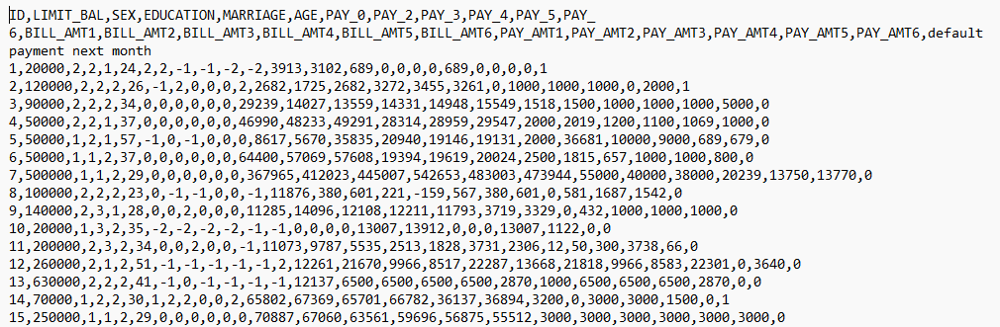
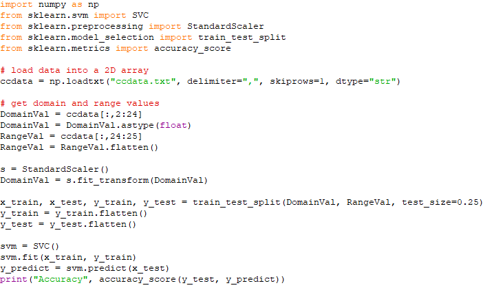
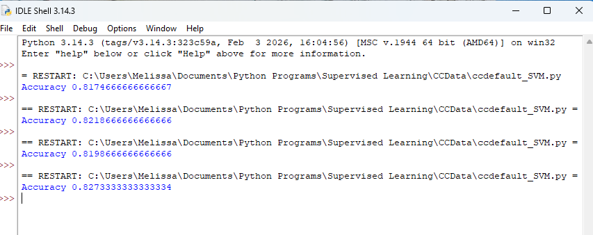

# Credit Default Prediction — SVM Model

## 📌 Overview
This project builds a Python-based machine learning model to predict whether a customer will default on their credit card. By analyzing structured data—like age, education, and payment history—the system uses a Support Vector Machine (SVM) algorithm to find patterns in consumer behavior and accurately forecast financial risk.

**Key Project Stages**

- **Data Transformation:** Converts raw customer data (demographics, billing history, and past payments) into clean features for analysis.
- **Model Training:** Teaches an optimized SVM classifier to recognize patterns that lead to credit card defaults.
- **Performance Evaluation:** Tests the model's accuracy to ensure reliable, high-precision risk forecasts.

**Core Data Used**

- **Demographics:** Age, gender, and marital status.
- **Financial Habits:** Education level, past bill amounts, and history of previous payments.

---

## 🎯 Objectives
- **Develop a predictive model** that identifies customers at high risk of credit card default.
- **Analyze behavioral and financial indicators** to understand drivers of default.
- **Demonstrate a full machine‑learning workflow** from preprocessing to evaluation.

---

## 🛠️ Tech Stack
- **Language:** Python  
- **Libraries:** NumPy, scikit‑learn  
- **Tools:** GitHub for version control and documentation  

---

## 📂 Repository Structure
```text
Credit-Default-SVM
│── /code        # Python scripts for preprocessing, modeling, evaluation
│── /data        # CSV dataset
│── /visuals     # Model outputs, charts, and screenshots
│── README.md
```

---

# 📸 Dashboard Preview

## Customer Credit Data Sample


## SVM Model Training Code


## SVM Prediction Output


---

# 📥 How to Use
1. **Clone** or download this repository.
2. **Open** the project files in your Python environment.
3. **Edit** the ccdefault_SVM.py file to include the path to the ccdata file on your local machine.
3. **Run** the Python program to generate predictions and view outputs.
